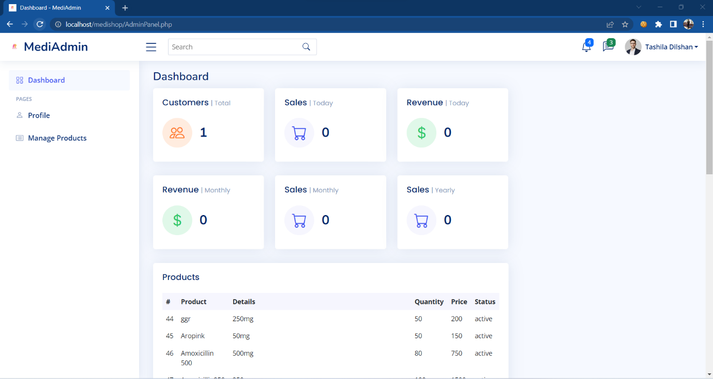

# 🏥 MediShop - Online Pharmacy & Medical Selling System

A complete, responsive online medical store and pharmacy management system built using PHP and MySQL. The system provides a seamless experience for Customers to buy medical products and a comprehensive Admin/Seller panel for inventory and user management.

---

## ✨ Key Features

👑 **Admin / Seller Panel:**
* Comprehensive Dashboard with sales and revenue tracking.
* Manage Products (Add, Update, Delete, active/deactive status).
* Recycle Bin feature to restore deleted products.
* User and Seller management.

🛒 **Customer Portal:**
* Secure User Registration and Login.
* Add to Cart and Watchlist functionalities.
* Secure checkout and Invoice generation.
* Update Profile details (Address, Province, District, City).
* Responsive UI with easy navigation and search functionality.

## 🛠️ Tech Stack
* **Frontend:** HTML5, CSS3, JavaScript, Bootstrap
* **Backend:** PHP (Core)
* **Database:** MySQL
* **Environment:** XAMPP / WAMP

## 🚀 How to Run Locally
1. Clone the repository:
   ```bash
   git clone [https://github.com/TashilaDilshanK/medishop-php.git](https://github.com/TashilaDilshanK/medishop-php.git)

# 📊 System Architecture

## 📸 System Screenshots

### 💻 Customer Interface


### ⚙️ Admin & Seller Interface





### 📊 System Architecture


Developed with ❤️ by Tashila Dilshan Kumara